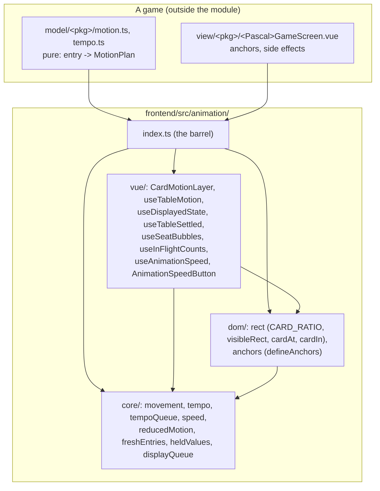

# Shared card animation module (frontend)

The pictures of a card table (flying copies, rings, arrows, a burst queue, Normal / Fast / Instant, reduced motion,
texts that follow the picture) live once, in `frontend/src/animation/`. A game keeps only its event -> motion mapping,
its anchors and its tempo numbers. The usage guide, with a complete example, is
[`frontend/src/animation/README.md`](../../frontend/src/animation/README.md); this page is the map.

Written 2026-10-24 from `origin/main` at `1edfe1d` (after chunks 0 to 3 of the plan, #297, #301, #302, #303). Spec:
`docs/specs/2026-10-21-shared-card-animation-design.md`; plan: `docs/plans/2026-10-21-shared-card-animation-plan.md`.

## Layers

| Layer | What | May import |
|-------|------|------------|
| `core/` | pure TypeScript, time passed in: `TableMovement`, `MotionPlan`, `eventSpanMs`, `scaleMovements`, `scalePlan`, `leg`, `createTempoQueue`, speeds, `prefersReducedMotion` / `canAnimate`, `freshEntries`, `heldValues`, `createDisplayQueue` | nothing of the module above it, no Vue (only shared leaves such as `model/Card`) |
| `dom/` | measuring places: `MotionRect`, `MotionTarget`, `CARD_RATIO`, `visibleRect`, `cardAt`, `cardIn`, `defineAnchors` | `core/`, no Vue |
| `vue/` | the overlay `CardMotionLayer`, the orchestrator `useTableMotion` and the composables | `core/`, `dom/`, Vue, shared leaves (`components/PlayingCard.vue`, `locales/format`) |
| `index.ts` | the public API | the three layers |

Rules, checked by `frontend/src/animation/boundaries.test.ts` (like the backend's ArchUnit rules): the layers above;
nothing in `animation/` imports a game (`view/`, `state/`, `model/<game>/`, `components/<game>/`); every file outside
the module imports the barrel (`../../animation`), never a file inside it. The rules every table follows (the picture
never gates the state, the first state never animates, Instant and reduced motion fly nothing, no game number and no
visible text in the module) are in the README.

## How an event becomes a picture

1. The store's log (newest first) gets a new entry. `useTableMotion` finds it (`freshEntries`; the log as it was at
   mount is already known, so a reload never animates).
2. The game's `plan(entry, { factor, still })` turns it into a `MotionPlan` (movements, optional `followUps` and
   `spanMs`), scaled to the speed with `scalePlan`.
3. Optional `prepare` (before admission) and `beforePlay` (after admission, its wait taken off the start).
4. The tempo queue admits it: it starts when the previous event's flights are over; past `maxQueued` / `maxLagMs`, or
   at Instant or under reduced motion, only its rings show, at once.
5. `CardMotionLayer.play` resolves the anchors through the game's `defineAnchors` resolvers and flies the copies.
6. `onPlayed(played, entry)` tells the game when the flights end (`endsAt`): holds, the texts' reveal
   (`useDisplayedState.revealIn`), counts.

A change that does not come from the log (President's exchange, Bullshit's discard and taken pile) goes through
`motion.play(plan)`, in the same queue.

## Who uses it

| Table | Uses | Game files |
|-------|------|------------|
| Kobo | log + `prepare` + `onPlayed` (held slot values, `heldValues`), seven anchor kinds, glow rings, no speed button | `view/kobo/KoboGameScreen.vue`, `model/kobo/motion.ts`, `tempo.ts`, `displayed.ts` |
| President | log + `followUps` / `spanMs` (the sweep) + `beforePlay` (the held closed pile) + `onPlayed` (texts told on landing), `motion.play` for the exchange, six anchor kinds, soft rings, `useDisplayedState`, `useSeatBubbles`, `useInFlightCounts`, `useTableSettled` (round sheet), speed button | `view/president/PresidentGameScreen.vue`, `composables/usePresidentEndSequence.ts`, `model/president/motion.ts`, `exchangeMotion.ts`, `tempo.ts`, `trickView.ts`, `endSequence.ts` |
| Bullshit | no log: `motion.play` for my discard and a taken pile, rectangle anchors measured at the move, `zIndex` 3000, `landing` + `easing`, no rings, no arrows, no speed button | `view/bullshit/BullshitGameScreen.vue`, `model/bullshit/motion.ts` |
| Mangola | `useAnimationSpeed` + `AnimationSpeedButton` only; its sowing replay is its own (`composables/useSowingAnimation.ts`) | `view/mangola/MangolaGameScreen.vue`, `components/mangola/MangolaBoard.vue` |
| Bataille Corse | nothing: its session waits for each animation (`awaitAnimation` / `notifyAnimationComplete`), the opposite contract (spec section 7.1) | `composables/useCardAnimation.ts`, `useGameAnimations.ts` |
| Three and Six Men's Morris | nothing: no card moves (a CSS transition on a piece, a glow on a mill) | `components/morris/MorrisBoard.vue` |

## Plugging a new game in

1. `model/<pkg>/tempo.ts`: the game's numbers (`LegTempo` per side, the queue's `QueueBounds`, ring durations).
2. `model/<pkg>/motion.ts`: the anchor type (a union on `kind`) and a pure `plan` per event, unit-tested.
3. In `view/<pkg>/<Pascal>GameScreen.vue`: `defineAnchors<Anchor>(() => screenEl.value, { ...one resolver per kind })`,
   `useTableMotion({ layer, bounds, log, plan, speed? })`, `<CardMotionLayer ref="layer" :resolve="resolve" />`, and
   if wanted `useAnimationSpeed` + `<AnimationSpeedButton>` with the game's texts from `locales/`.
4. Texts that must follow the picture: `useDisplayedState` (President). A click judged on what is shown:
   `heldValues` (Kobo). Something that waits for the table to finish (an end sheet): `useTableSettled`.
5. Tests: the `plan` functions in `model/<pkg>/motion.test.ts`; the screen with a stubbed layer recording its `play`
   calls (`view/kobo/KoboGameScreen.motion.test.ts`, `view/president/PresidentGameScreen.motion.test.ts`); a Cypress
   spec frozen mid-flight under `cy.clock` (`kobo-animations.cy.ts`, `president-animations.cy.ts`,
   `bullshit-pile-animation.cy.ts`).

The README's "Crazy Eights" example is that recipe in about 30 lines, and `animation/example.test.ts` runs it on a fake
table.

## Not in the module (owner decisions, spec section 9)

Kobo's speed button, opponents' discards flying in Bullshit, pieces sliding in Morris, one ring look for every table:
visible changes, each to go through a Claude Design canvas first.
