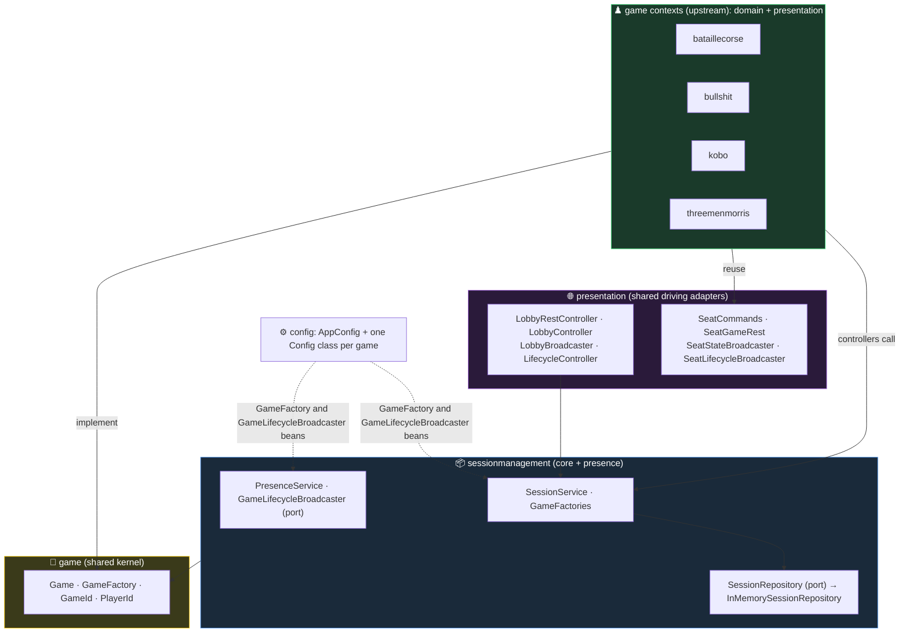
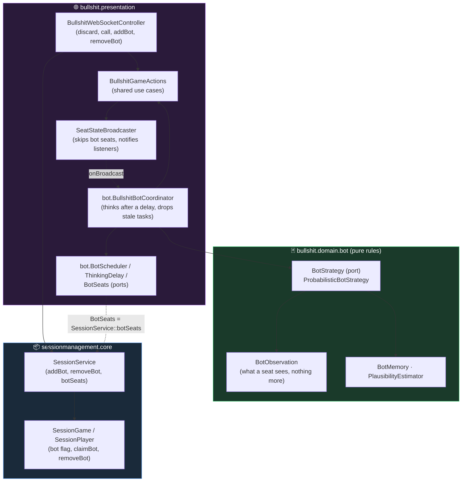
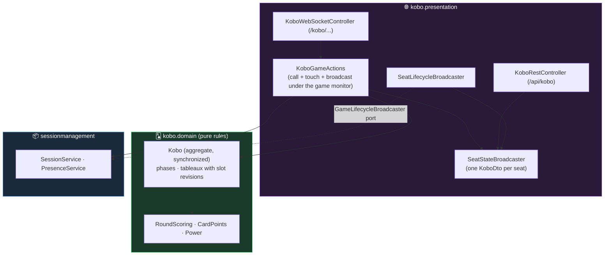

# Backend Context Map

Four game contexts, a session context, a shared kernel and a shared presentation layer, under
`backend/src/main/java/org/kevinkib/cardgames/`. Naming rules: `game-conventions.md`; how to add a game:
`add-a-game.md`.

| Package | Role |
|---------|------|
| `game` | Shared kernel: `Game`, `GameFactory`, `GameId`, `PlayerId`, `GameOptions`, `OptionDescriptor`. Knows no concrete game. |
| `sessionmanagement` | `core` (seats, tokens, create / join / start / play again, bots as flagged seats) and `presence` (connection, grace period, forfeit). Depends only on `game`. |
| `bataillecorse`, `bullshit`, `kobo`, `threemenmorris` | One bounded context per game: `domain` (pure rules) and `presentation` (controllers, use cases, DTOs, bots). No game knows another. |
| `presentation` | Shared driving adapters: lobby, presence, session REST, WebSocket configuration, `SeatCommands`, `SeatGameRest`, the seat broadcasters, bot ports. Knows no concrete game. |
| `config` | `AppConfig` (shared beans) and one `<Game>Config` per game. |

The ArchUnit test `ArchitectureTest` locks these arrows; see "Shared backend building blocks".

## Bounded Contexts

**BatailleCorse** — upstream, pure game rules. `BatailleCorse` is the aggregate root, `BatailleCorseFactory` its factory (type `bataille-corse`). No knowledge of sessions, tokens, or transport. It is the legacy outlier: its REST base (`/api/game/{id}`) and commands (`/app/send`, `/app/slap`, `/app/grab`) carry no game segment, and it keeps its own `BatailleCorseStateBroadcaster` (one public state for the room) and `BatailleCorseLifecycleBroadcaster` instead of the seat broadcasters; its controllers do use `SeatCommands` and `SeatGameRest`.

**BatailleCorse computer seats** — a room seat held by a bot is played by the server. The pure part lives in `bataillecorse/domain/bot` (`BatailleCorseBotTier`: the nine tiers of the former local AI; `BatailleCorseBotStrategy`: slap, send or nothing, read from the rules in force). `BatailleCorseBotCoordinator` (`presentation/bot`) listens to the `BatailleCorseStateBroadcaster`, schedules the bot after its tier reaction time (seat option `tier`, 0 to 8, default 1, plus `bataillecorse.bots.extra-delay-ms`), re-checks `BatailleCorse.version()` under the game monitor before acting, and collects a won pile for the bot after 1500 ms (`autoGrabPlayer()`). It uses the same `BatailleCorseGameActions` as a human, starts on START, stops on game end, forfeit or eviction, and restarts on the next START after Play again. `bataillecorse.bots.enabled=false` switches it off.

**Bullshit** — upstream game rules (`org.kevinkib.cardgames.bullshit`), depending only on the `game` kernel and `frenchcards`. `Bullshit` is the aggregate root; the claim/match mechanic sits behind a pluggable `ClaimMode` strategy (ascending-rank over the deck in play, or a suit variant that draws a random starting suit each round through an injected `RandomGenerator`); the deck (`DeckSize`: 32 cards from 7 to Ace, or 52) is a creation option. Played through `BullshitWebSocketController` (`/app/bullshit/start`, then the unprefixed legacy commands `/app/discard` and `/app/callBullshit`) and `BullshitRestController` (`/api/bullshit`), with bots (next section).

**Session Management** — downstream of the kernel only: it never learns a concrete game. Two sub-contexts:
- *core* — `SessionService` creates rooms through `GameFactories` (built from every `GameFactory` bean), and `SessionGame` ties a game ID to its seats (`SessionPlayer`, humans or bots); `SessionToken` maps each seat to a secret token that authenticates actions. `SessionRepository` is a port, `InMemorySessionRepository` the adapter.
- *presence* — `PresenceService` tracks connections, the grace period and forfeits, and reaches each game through the `GameLifecycleBroadcaster` port (one bean per game, collected by `GameLifecycleBroadcasters`).

**presentation** — the shared driving adapters (lobby, presence, session REST, WebSocket configuration, `SeatCommands`, `SeatGameRest`, the seat broadcasters, bot ports). No domain logic and no concrete game; each game adds its own controllers in `<game>.presentation`.

## Bullshit bot players

Spec: `docs/specs/2026-10-10-bullshit-bots-design.md`. A bot is a flagged seat of the game-agnostic session core; how it plays lives in the Bullshit context behind a port, and the glue that knows both sits in the Bullshit presentation layer, like the WebSocket controller.

- **Session core**: a bot seat counts as joined, has no presence and no forfeit timer, and its internal token never resolves (`findPlayerByToken`, `findTokenByPlayer`) nor appears in a lobby view. Only the host adds or removes bots, before the game starts, and only for a game whose factory `supportsBots()`; a bot can be removed only where no human sits after it (`LobbyView.removableBotSeats`), so the dealt seats stay contiguous. Play again reopens the lobby with the former bots re-seated in order right after seat 0, with their names and seat options; humans come back one by one and the first caller is the host.
- **Bullshit domain**: the strategy only ever receives a `BotObservation`, built to carry exactly what `BullshitDto.forViewer` shows (a parity test and a structural test enforce it). `Bullshit.version()` lets asynchronous bot tasks detect that the table moved on.
- **Dependencies**: `sessionmanagement` never learns a game; the coordinator reaches the session core only through the `BotSeats` port (`SessionService::botSeats`) and the eviction listener.

## Kobo

Spec: `docs/specs/2026-10-11-kobo-backend-design.md`. A third upstream game-rules context (`org.kevinkib.cardgames.kobo`), plugged into the session core through a `KoboFactory` collected by `GameFactories`; nothing changes in `sessionmanagement`.

**Fixed deal for e2e** — the deal comes from the `DeckSource` port of `kobo/domain` (`RandomDeckSource` by default). Under the Spring `test` profile only, `ScriptedDeckSource` and `KoboTestDealController` (`PUT`/`DELETE /api/test/kobo/{gameId}/deal`, `{"round":1,"cards":["KH","10S",...]}` in deal order, seat 0 first) let a test choose the leading cards of a round before `start`; the route does not exist in any other profile. This is the model for any random game (`add-a-game.md`, Determinism).

- **Slots and revisions**: every command addresses a card as `SlotRef(seat, slot)`; each slot has a `revision` bumped when its card changes. The server never learns what a player remembers; clients drop what they knew of a slot whose revision moved.
- **The race**: any player may try to discard a card (own or another's) that matches the rank on top of the discard pile. Commands go through the `synchronized` aggregate, so the first message processed wins. A losing attempt (slot already emptied or refilled, or the pile moved) is rejected without penalty (`expectedTopRank`, `expectedRevision`); only a real rank error costs a penalty card.
- **Privacy**: `KoboDto.forViewer` is the only projection. Face-down values appear only in the viewer own DTO (starting cards before the first draw, the drawn card while deciding, the last peek) and in everyone's DTO once the round is revealed.
- **Frontend**: registered in the game selection, with its lobby and game screen (`KoboSession`, `Kobo.store`, `view/kobo/KoboGameScreen.vue`); the table itself is in progress (issue #149). **Not covered yet**: bots.

## Three Men's Morris

Spec: `docs/specs/2026-10-11-three-men-morris-backend-design.md`. A fourth upstream game-rules context (`org.kevinkib.cardgames.threemenmorris`), two players, plugged into the session core through a `ThreeMenMorrisFactory` (type `three-men-morris`, lobby option `variant` = `tapatan|achi|picaria`, default `tapatan`) collected by `GameFactories`; nothing changes in `sessionmanagement`. `ThreeMenMorrisWebSocketController` (`/app/three-men-morris/start|place|move`, over `SeatCommands`) and `ThreeMenMorrisRestController` (`/api/three-men-morris`, over `SeatGameRest`) authenticate by seat token and delegate to `ThreeMenMorrisGameActions` (call, touch, one broadcast of a `ThreeMenMorrisDto` per seat through a `SeatStateBroadcaster<ThreeMenMorris, ThreeMenMorrisDto>`); a `SeatLifecycleBroadcaster<ThreeMenMorris>` serves presence and forfeit. Both are beans of `config/ThreeMenMorrisConfig.java`. The rules (board, placement, movement, lines, blocked player) live in the `ThreeMenMorris` aggregate. The variants are data, not classes: `MorrisVariant` maps an option key to a `MorrisRules` (`Geometry`, pieces per player, `PlacementRule`): Tapatan (3 pieces), Achi (4 pieces, one hole) and Picaria (3 pieces, four short diagonals, centre closed during the whole placement phase, reachable by a move). The DTO adds `variant` and `legalPlacements` only for Achi and Picaria, so the Tapatan wire is byte-identical to v1. Frontend: registered and playable (`docs/specs/2026-10-13-three-men-morris-frontend-design.md`). Not covered yet: bots (v2: `docs/specs/2026-10-14-three-men-morris-v2-design.md`, issue #147).

## Shared backend building blocks

Spec: `docs/specs/2026-10-12-backend-mutualization-design.md`. The presentation and wiring code that the games copied from one another now lives once; each game keeps its controllers (explicit mappings), its `*GameActions`, its DTO projection and its bots.

- **`SeatCommands`** (`presentation/command`, bean in `AppConfig`): authenticates a seat from the game id and token, runs the action, and answers a refused command to the sender alone with an `ErrorResponse(type, message, state)`. An unknown or malformed id, or an unknown token, is ignored (debug log). The sender's state is attached whenever a game runs. Used by the WebSocket controllers of all four games.
- **`SeatGameRest`** (`presentation/rest`): the state / join / play-again REST endpoints of a game, used by all four REST controllers.
- **`SeatStateBroadcaster<G, Dto>` and `SeatLifecycleBroadcaster<G>`** (`presentation/state`): one DTO per seat, and presence / forfeit through the `GameLifecycleBroadcaster` port; declared per game in its configuration class (Bullshit, Kobo, Three Men's Morris; Bataille Corse keeps its own pair). `LobbyBroadcaster` sends the per-viewer lobby views of every game.
- **Architecture test**: `ArchitectureTest` (test root `architecture/`, ArchUnit `archunit-junit5`, test scope, main classes only) locks five rules: `sessionmanagement` and the `game` kernel know no concrete game, presentation or config; each game's `domain` knows no Spring, session, presentation or config (one case per game); no game depends on another game; the shared `presentation` package knows no concrete game; no cycles between top-level packages. The per-game cases come from hand-written lists (`ArchitectureRules.GAMES` and two `@ValueSource` in `ArchitectureTest`): a new game must be added there, nothing fails otherwise.
- **`CardDto` and `CardLabels`** (`presentation.dto`): one null-safe card record (`rank`, `suit`, `name`) and one parser from the published rank and suit labels back to a `Card`, shared by Bataille Corse, Bullshit and Kobo.
- **One Spring configuration per game** (`config/BatailleCorseConfig`, `BullshitConfig`, `KoboConfig`, `ThreeMenMorrisConfig`): factory, broadcasters, actions and bots of that game. `AppConfig` keeps the shared beans, and `GameFactories` is built from every `GameFactory` bean.
- **`SessionService.startGame(GameId, String token, Class<T>)`** returns the typed game, so controllers no longer cast. The game-type check stays in each `start` handler, before the call (Bullshit included: "This room is not a Bullshit game").
- **`SessionToken(String)` is tolerant** (#155): a value that is not a UUID becomes a name-based (version 3) UUID that no seat holds, so a malformed token is an unknown token everywhere (REST 403, WebSocket commands ignored) instead of an exception.
- **Shared test kit** (`src/test/.../presentation/support`): `RecordingMessaging` (records seat, game and token messages), `StompTestClient` (STOMP client for the integration tests, with `Frames` that wait on received frames), `SessionTable` (in-memory repository, `SessionService` and `RecordingMessaging` over given factories).

## Relationship

`sessionmanagement` has a **Conformist** relationship to the shared kernel: it speaks the kernel's language (`Game`, `GameFactory`, `GameId`, `PlayerId`) without translation, and never a concrete game's. The game contexts implement the kernel and know nothing of sessions; their `presentation` layer is the only place where a game meets the session core.
