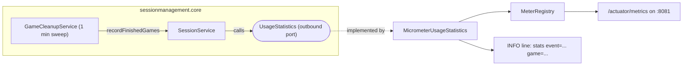

# Usage statistics

Goal: tell whether the site is really played (games created, started, finished, rematches, seats, bots), with no
database, no third-party tracker and no personal data. The operator's how-to is the README section "Usage statistics".

## Shape

- **Port**: `UsageStatistics` in `sessionmanagement.core.application.port` (`gameCreated`, `gameStarted`,
  `gameFinished`, `rematch`, `seatJoined`, `botAdded`). It receives only the game type key and counts. `UsageStatistics.NONE`
  is the no-op default (the two-argument `SessionService` constructor uses it); tests use `RecordingUsageStatistics`.
- **Adapter**: `MicrometerUsageStatistics` (`sessionmanagement.core.infrastructure`) increments a counter tagged
  `game` and writes the log line on the `usage.stats` logger. `AppConfig` wires it and registers the two gauges
  (`cardgames.rooms.open` from `SessionRepository.roomCount()`, `cardgames.players.connected` from
  `ConnectionRegistry.size()`).
- **Hooks**: the `SessionService` use cases (create, join, add bot, start, play again). The game domains
  (`<game>/domain`) know nothing about metrics: `ArchitectureRules.gameDomainIsPure` forbids `io.micrometer..` like
  Spring, and `sessionmanagement` still depends on no concrete game.
- **Finished games** have no single hook (a win happens inside a game action, a forfeit in `PresenceService`). The
  cleanup sweep calls `SessionService.recordFinishedGames()` before it evicts anything: each ended game is reported
  once (a set of already-reported ids, pruned to the games still held). A game reopened for a rematch is reported
  just before the `rematch` event, so a quick rematch does not lose it. Precision is the sweep period (1 minute).
- **Rematch** is counted once per reopening of the room, not once per player who clicks Play Again.

## Not covered

- Real WebSocket sessions: the gauge counts seats bound to a connection (a player who opened the table), which is
  what "people playing now" means; a browser that connected without taking a seat is not counted.
- History: counters live in memory and reset at redeploy; the log lines are the durable record.

## Security

Actuator is exposed on its own port (`management.server.port=${MANAGEMENT_PORT:8081}`), restricted to
`health,metrics`. The gateway proxies only `/api/` and `/connect/` to port 8080, and `docker-compose.prod.yml`
publishes no port, so the endpoints are reachable only from inside the container network (for example
`docker compose exec backend wget -qO- localhost:8081/actuator/metrics`). Surefire sets `MANAGEMENT_PORT=0` so the
Spring contexts of different tests never fight for 8081.
